# Caderno de Bolso

**O comprador confere sozinho de onde vem o alimento, e a visita de pares ganha um roteiro de apoio no celular.**

Site do Caderno de Bolso, um complemento digital do caderno de campo para agricultores familiares
agroecológicos com certificação participativa (SPG) no Território de Irecê, Bahia. Ele atende quem
compra na feira, quem faz a visita de pares e a coordenação do grupo.

- Site publicado: https://andessonreis.github.io/caderno-de-bolso-web/
- Aplicativo de celular (anotações na roça, sem internet): https://github.com/Andessonreis/caderno-de-bolso-mobile
- Fluxos de cada tela: [docs/fluxos.md](docs/fluxos.md)
- Todas as telas, numeradas na ordem de uso: [docs/telas](docs/telas/README.md)

<p>
  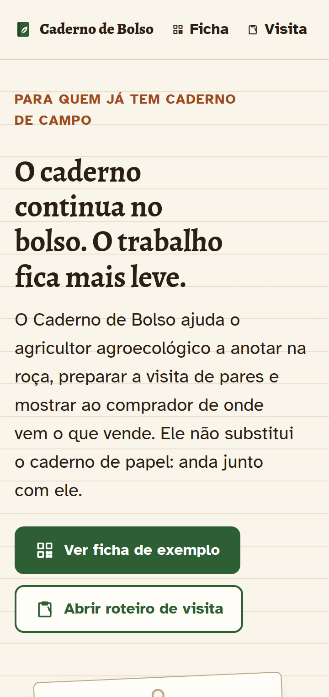
  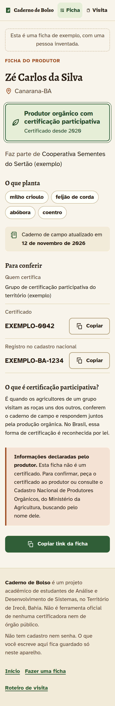
  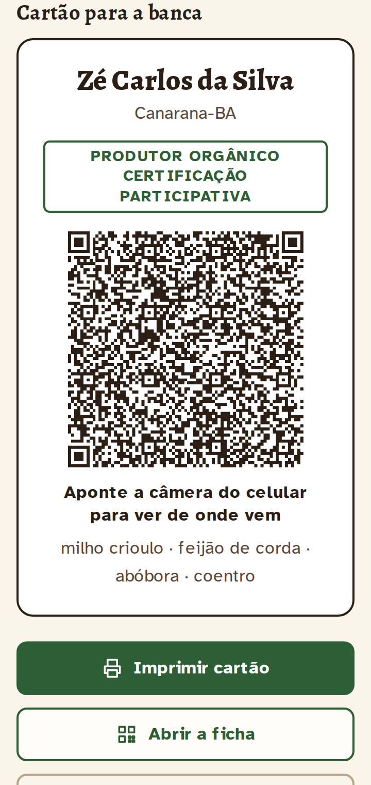
  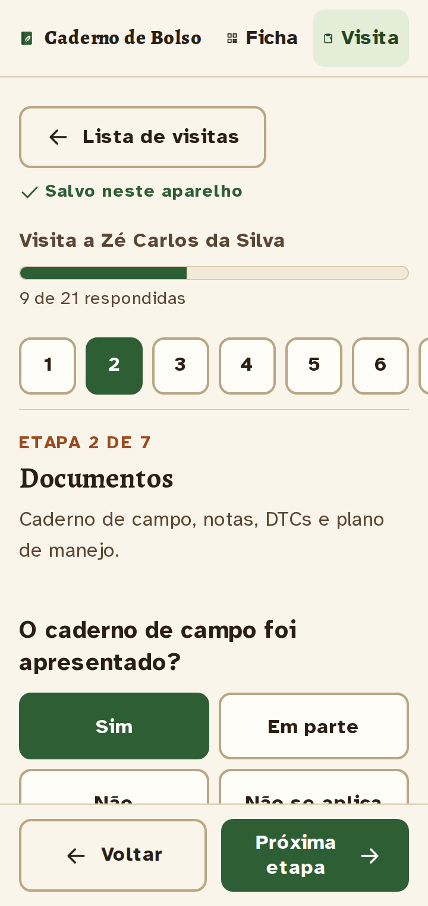
</p>

## O problema

Das entrevistas com agricultores certificados pelo sistema participativo, o site parte de três
pontos:

- **Provar a cada venda que é orgânico.** Na feira, o produtor mostra foto no celular ou convida o
  comprador para conhecer a roça. Não há um jeito rápido de o comprador conferir sozinho.
- **A visita de pares é longa.** Três vezes por ano, agricultores do grupo visitam a roça uns dos
  outros, conferem o caderno de campo e seguem o roteiro de visita da OPAC. Um produtor disse que a
  visita toma o dia inteiro. Encurtar esse tempo é uma hipótese a testar.
- **Estar pronto para a visita.** O caderno de papel continua sendo o registro oficial, e os
  produtores querem estar sempre em dia para a visita e para auditorias surpresa.

O Caderno de Bolso não substitui o caderno de papel: anda junto com ele. O aplicativo cuida da
anotação na roça. Este site cuida das outras duas pontas.

## O que o site faz

**Ficha do produtor (`/ficha`).** O comprador aponta a câmera para o QR da banca e, sem instalar
nada, vê quem produz, de onde é, o que planta, desde quando tem certificação participativa, quando
o caderno de campo foi atualizado e os números para conferir o certificado, com botão de copiar.
A página explica em duas frases o que é certificação participativa e diz com clareza que os dados
são declarados pelo produtor, indicando como confirmá-los. O comprador pode compartilhar a ficha.

**Gerador de ficha e cartão (`/ficha/criar`).** Para o produtor ou a cooperativa montar a ficha sem
o aplicativo: um formulário curto gera o link, o QR (feito no próprio aparelho) e um cartão no
tamanho A6, pronto para imprimir e deixar na banca. Também baixa a imagem do QR.

**Roteiro de apoio à visita (`/visita`).** Quem faz a visita de pares preenche no celular ou tablet,
tocando em botões grandes (Sim, Em parte, Não, Não se aplica), em sete etapas: identificação,
documentos, sementes e mudas, insumos e manejo, colheita e armazenamento, controle e fechamento.
As perguntas se ajustam ao que é visto: a comprovação de origem só aparece para algodão, feijão,
milho e soja, e a separação do produto só é pedida quando o armazém é compartilhado. Tudo é salvo
no aparelho a cada toque. No fim, um resumo mostra o que ficou sem resposta, e a visita sai numa
folha limpa para imprimir ou salvar em PDF, com espaço para assinaturas. Um arquivo leva a visita
de um aparelho para outro. Depois de aberto uma vez, o roteiro funciona sem internet. O roteiro é um
apoio baseado no Roteiro de Visita da OPAC e cobre só parte dele (documentos, sementes, insumos,
colheita e controle). Não substitui o formulário oficial, e o uso em visitas reais depende de acordo
com o grupo e a OPAC.

**Visitas do grupo (`/grupo`).** Para a coordenação de um núcleo, associação ou cooperativa. A
coordenação cria o grupo com um nome e recebe duas coisas: o código do grupo, num cartão com QR
para imprimir e entregar aos membros, e o link da coordenação, só dela. Cada membro digita o código
no aplicativo e escolhe quais visitas enviar. Pelo link, a coordenação vê todas num lugar só: um
resumo (total, pareceres, produtores visitados e as perguntas com mais "Não" e "Em parte"), a
lista com filtro por parecer e busca pelo nome, cada visita completa na folha de impressão e uma
planilha CSV para o Excel. O grupo pode ser apagado, com tudo o que foi reunido.

<!-- telas:inicio -->

## Telas

As 18 telas do site no celular, na ordem de uso. Toque numa imagem para ampliar. O índice com como chegar em cada tela e o que ela faz está em [docs/telas](docs/telas/README.md).

### Página inicial

<table>
  <tr>
    <td align="center" valign="top"><a href="docs/telas/01-inicio.png"></a><br><sub><b>01</b> · Página inicial</sub></td>
  </tr>
</table>

### Ficha do produtor

O que o comprador vê ao ler o QR da banca.

<table>
  <tr>
    <td align="center" valign="top"><a href="docs/telas/02-ficha.png"></a><br><sub><b>02</b> · Ficha válida</sub></td>
    <td align="center" valign="top"><a href="docs/telas/03-ficha-sem-codigo.png">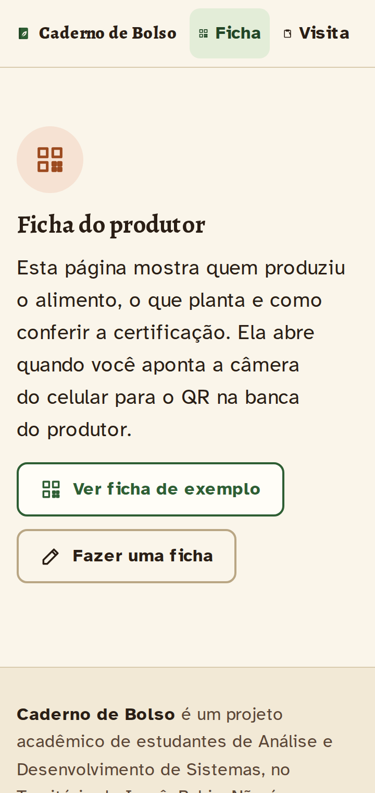</a><br><sub><b>03</b> · Ficha sem código</sub></td>
    <td align="center" valign="top"><a href="docs/telas/04-ficha-codigo-ilegivel.png">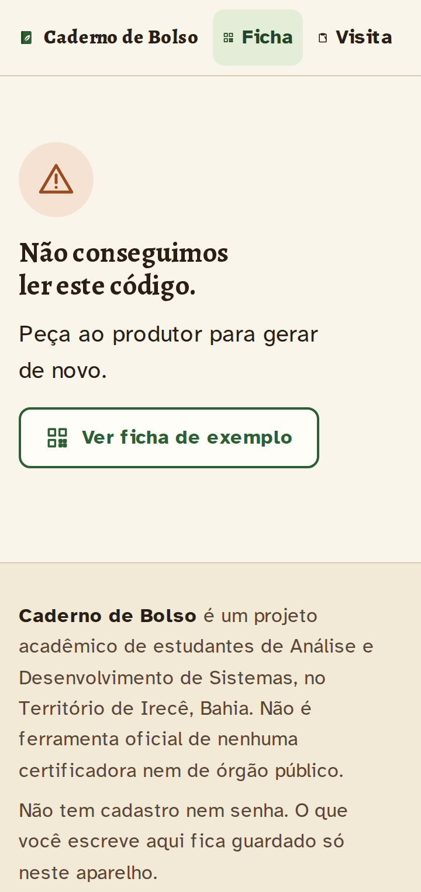</a><br><sub><b>04</b> · Código que não dá para ler</sub></td>
  </tr>
</table>

### Fazer uma ficha

Para o produtor ou a cooperativa montar a ficha sem o aplicativo.

<table>
  <tr>
    <td align="center" valign="top"><a href="docs/telas/05-criar-ficha-vazio.png">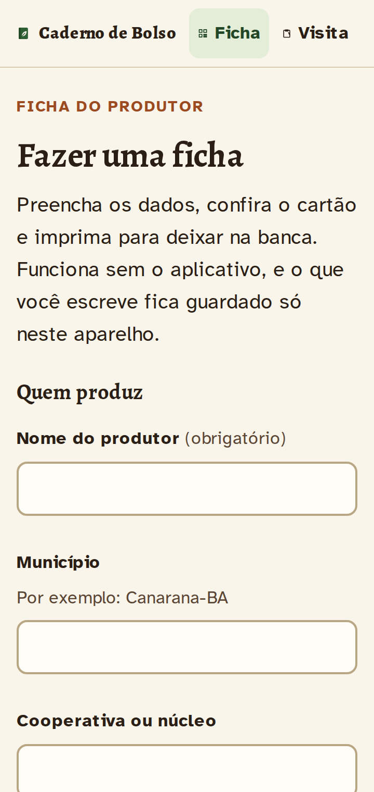</a><br><sub><b>05</b> · Formulário vazio</sub></td>
    <td align="center" valign="top"><a href="docs/telas/06-criar-ficha-preenchido.png">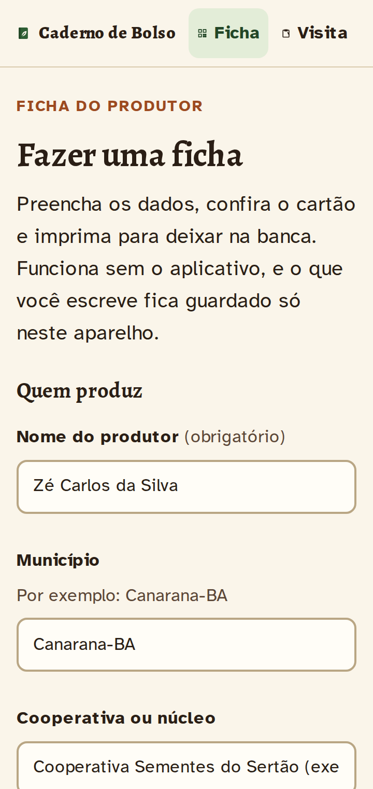</a><br><sub><b>06</b> · Formulário preenchido</sub></td>
    <td align="center" valign="top"><a href="docs/telas/07-criar-ficha-cartao-para-a-banca.png"></a><br><sub><b>07</b> · Cartão para a banca</sub></td>
  </tr>
</table>

### Roteiro de apoio à visita

Para quem faz a visita de pares. Funciona sem internet depois de aberto uma vez.

<table>
  <tr>
    <td align="center" valign="top"><a href="docs/telas/08-visita-lista-vazia.png">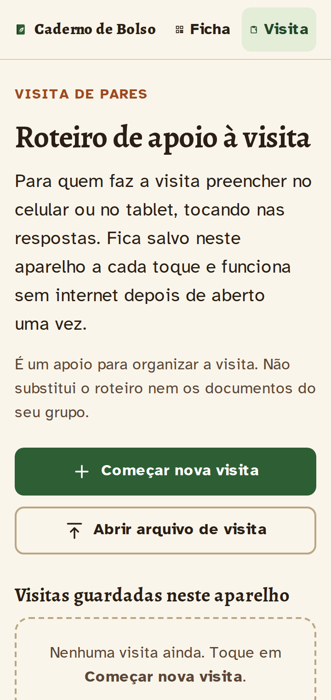</a><br><sub><b>08</b> · Lista de visitas vazia</sub></td>
    <td align="center" valign="top"><a href="docs/telas/09-visita-lista.png">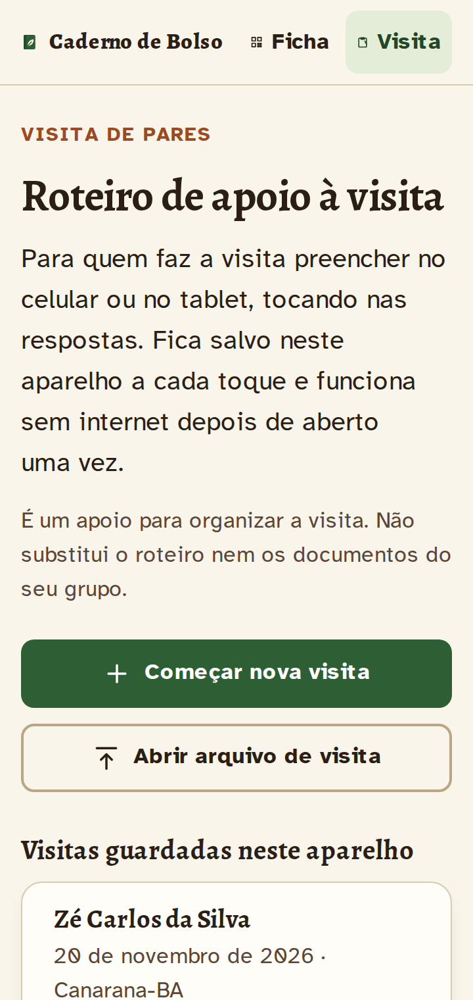</a><br><sub><b>09</b> · Lista de visitas</sub></td>
    <td align="center" valign="top"><a href="docs/telas/10-visita-etapa-1-quem-e-quando.png">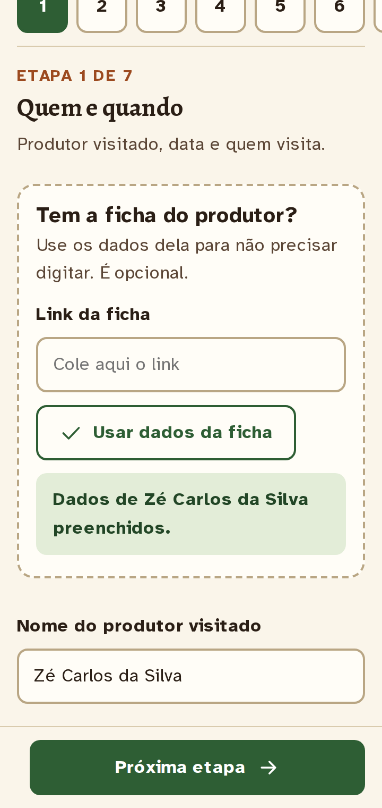</a><br><sub><b>10</b> · Etapa 1: Quem e quando</sub></td>
    <td align="center" valign="top"><a href="docs/telas/11-visita-etapa-2-documentos.png"></a><br><sub><b>11</b> · Etapa 2: Documentos</sub></td>
  </tr>
  <tr>
    <td align="center" valign="top"><a href="docs/telas/12-visita-etapa-3-sementes-e-mudas.png">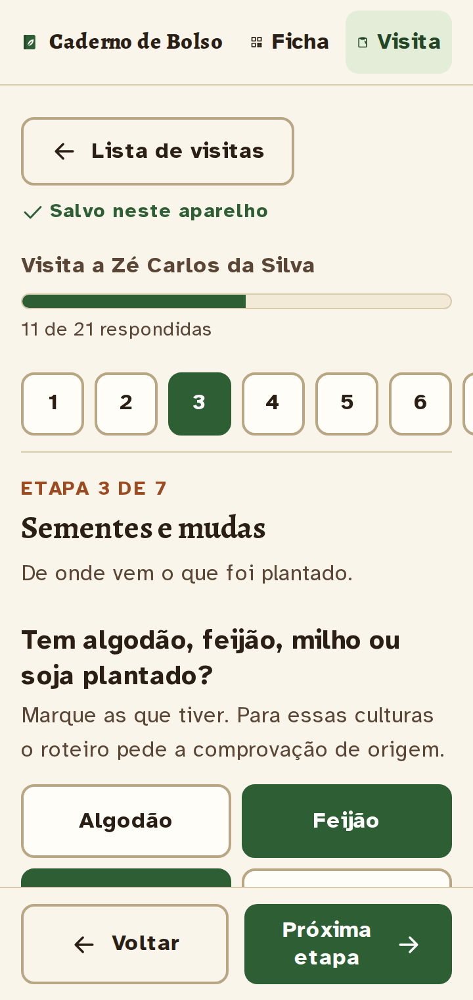</a><br><sub><b>12</b> · Etapa 3: Sementes e mudas</sub></td>
    <td align="center" valign="top"><a href="docs/telas/13-visita-etapa-4-insumos-e-manejo.png">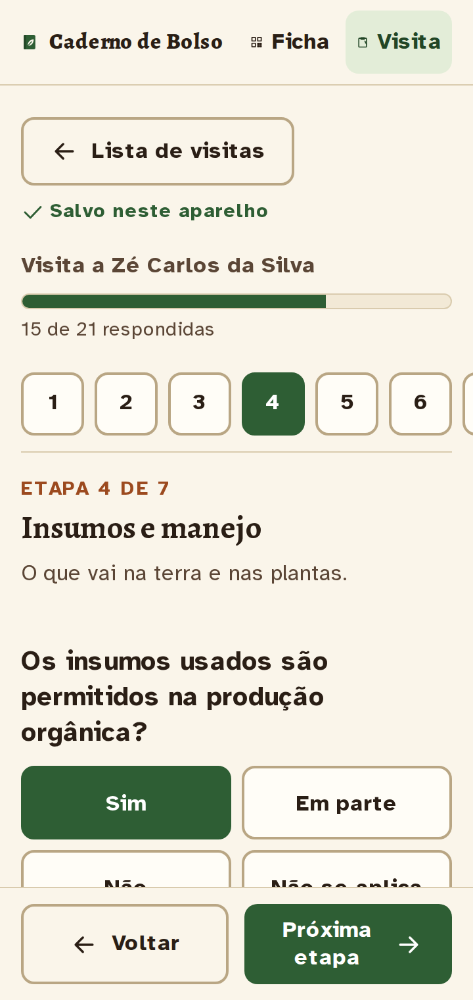</a><br><sub><b>13</b> · Etapa 4: Insumos e manejo</sub></td>
    <td align="center" valign="top"><a href="docs/telas/14-visita-etapa-5-colheita-e-armazenamento.png">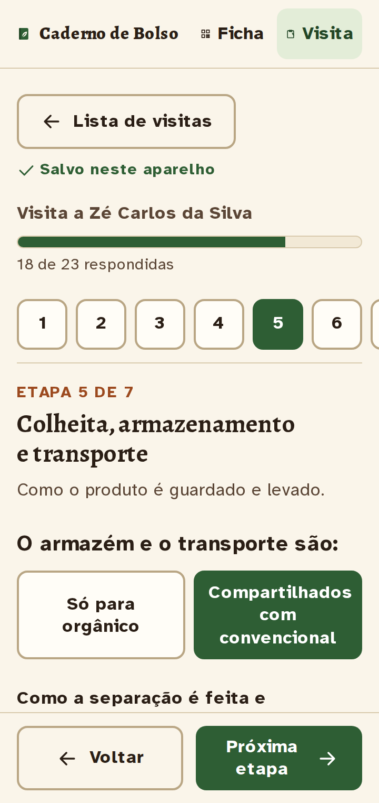</a><br><sub><b>14</b> · Etapa 5: Colheita, armazenamento e transporte</sub></td>
    <td align="center" valign="top"><a href="docs/telas/15-visita-etapa-6-controle.png">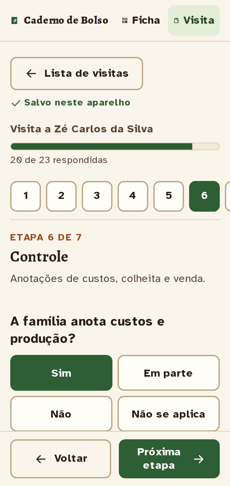</a><br><sub><b>15</b> · Etapa 6: Controle</sub></td>
  </tr>
  <tr>
    <td align="center" valign="top"><a href="docs/telas/16-visita-etapa-7-fechamento.png">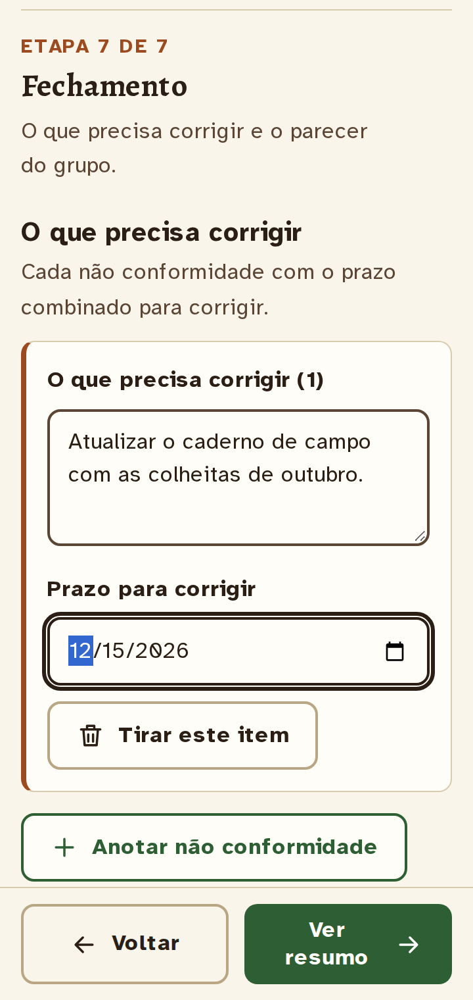</a><br><sub><b>16</b> · Etapa 7: Fechamento</sub></td>
    <td align="center" valign="top"><a href="docs/telas/17-visita-resumo.png">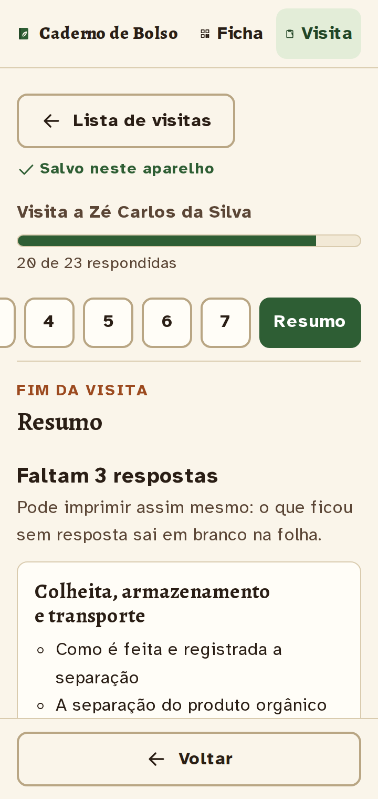</a><br><sub><b>17</b> · Resumo</sub></td>
  </tr>
</table>

### Outras

<table>
  <tr>
    <td align="center" valign="top"><a href="docs/telas/18-pagina-nao-encontrada.png">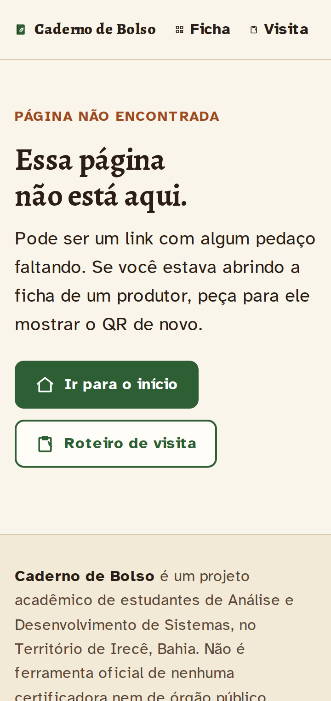</a><br><sub><b>18</b> · Página não encontrada</sub></td>
  </tr>
</table>
<!-- telas:fim -->

## Decisões de engenharia

**Os dados vão no link, não num servidor.** A ficha viaja inteira no endereço
(`/ficha/#d=<payload>`), em JSON codificado em base64url. Como fica depois do `#`, o conteúdo nunca
é enviado a servidor nenhum. Não há cadastro, login nem banco de dados para manter, e o QR continua
funcionando enquanto o site existir. O formato é um contrato versionado, compartilhado com o
aplicativo:

```jsonc
{
  "v": 1, // versão do formato
  "n": "nome do produtor", // único campo obrigatório
  "m": "município",
  "c": "cooperativa ou núcleo",
  "o": "organismo de certificação participativa",
  "ct": "identificação do certificado",
  "d": 2020, // certificado desde (ano)
  "r": "registro no cadastro nacional de produtores orgânicos",
  "s": "código do sistema de rastreio que já usa",
  "cu": ["milho crioulo", "feijão"], // até 12 culturas
  "u": "2026-11-20", // última anotação no caderno
}
```

**Toda entrada é tratada como não confiável.** Um QR pode ser adulterado, e um arquivo de visita
pode vir de qualquer lugar. A leitura (`src/lib/ficha.ts`, `src/lib/armazenamento.ts`) confere
tipos, remove caracteres de controle e de inversão de texto, limita tamanhos, trunca listas,
valida datas de calendário e descarta campos desconhecidos. Nenhum dado de fora é inserido como
HTML. Versão desconhecida e payload corrompido viram uma mensagem amigável. Se os dados guardados
no aparelho estragarem, uma cópia do conteúdo cru é preservada antes de qualquer regravação.
Ao abrir o arquivo de uma visita que já existe, o site compara as datas e pergunta antes de trocar
uma cópia mais nova.

**Grupo com dois segredos, sem login.** O código do grupo (10 letras) só serve para enviar
visitas; a chave da coordenação (32 bytes aleatórios) só serve para ler. Os dois são gerados no
navegador com `crypto.getRandomValues`, e o servidor guarda apenas o sha256 de cada um, nunca o
código ou a chave em si. A chave vai no link da coordenação depois do `#` (`/grupo/#g=<id>&k=<chave>`), parte do endereço que o navegador não manda
para o servidor do site, e só sai do aparelho no corpo da chamada ao servidor do grupo. O membro que
envia não consegue ler as visitas dos outros, e quem lê não precisa de conta. As chamadas são três
funções do banco expostas por HTTP (`src/lib/servidorGrupo.ts`), feitas com `fetch` e a chave
pública do projeto. As visitas recebidas passam pela mesma leitura defensiva dos arquivos de visita,
e a planilha protege contra fórmulas (célula que começa com `=`, `+`, `-` ou `@` ganha um apóstrofo).
Quem tem o código do grupo pode enviar visitas, então ele só deve ir para os membros. O servidor
limita o grupo a 5000 visitas; a lista mostra as 2000 mais recentes, com o total indicado.

**Exportação estática.** O Next.js gera HTML, CSS e JavaScript prontos (`output: "export"`), que
qualquer hospedagem estática serve. O site pode morar na raiz do domínio ou num subcaminho
(`NEXT_PUBLIC_BASE_PATH`), como no GitHub Pages. Fontes são servidas pelo próprio site, sem CDN
em tempo de uso.

**Service worker próprio, pequeno e legível** (`public/sw.js`). Arquivos com hash são servidos do
cache. Páginas tentam a rede primeiro com tempo limite curto e caem para a cópia guardada, o que
ajuda com internet instável. Na instalação, as páginas principais e os arquivos que elas usam são
guardados. A cada build, um script grava no service worker uma versão derivada do conteúdo
(`scripts/versao-sw.mjs`). O navegador instala a versão nova, e ela apaga só os caches antigos
deste site.

**Feito para quem tem pouca familiaridade com o celular.** Português simples, sem jargão e sem
inglês. Texto base de 17px, alvos de toque de pelo menos 48px, contraste AA ou melhor para leitura
ao sol, todo ícone acompanhado de texto, HTML semântico, foco visível, navegação por teclado,
grupos de botões que são rádios de verdade para leitores de tela, movimento mínimo respeitando
`prefers-reduced-motion`. Campos mostram um contador perto do limite, para nada ser cortado sem
aviso. A identidade visual usa papel, terra e verde-folha, com Alegreya nos títulos e Atkinson
Hyperlegible no texto.

**Lógica em funções puras e testadas.** Codificação da ficha, modelo do roteiro (perguntas como
dados, não como telas repetidas), cálculo de progresso, armazenamento e prefixo de caminho são
funções puras com testes em Vitest. A interface só as chama.

## Stack

- Next.js 16 (App Router, exportação estática) com React 19 e TypeScript em modo estrito
- CSS Modules com tokens de design em variáveis CSS
- `qrcode` para gerar o QR no navegador
- Vitest para testes e ESLint (configuração do Next) para lint
- GitHub Actions e GitHub Pages para publicação

## Estrutura

```
src/
  app/
    page.tsx               página inicial
    ficha/                 ficha do produtor (leitura do QR)
      criar/               gerador de ficha, QR e cartão A6
    visita/                roteiro de apoio à visita: lista, etapas, resumo e folha de impressão
    grupo/                 visitas do grupo: criar o grupo, código, link da coordenação e painel
    manifest.ts            manifesto do app instalável
    not-found.tsx          página 404
  components/              cabeçalho, rodapé, ícones, botão de copiar, contador
  lib/
    ficha.ts               contrato da ficha: codificar, ler com segurança, datas
    visita.ts              perguntas do roteiro como dados, progresso e pendências
    armazenamento.ts       visitas no aparelho, arquivo de exportação, reserva de dados estragados
    grupo.ts               código, chave, link da coordenação, visitas recebidas, resumo e planilha
    servidorGrupo.ts       chamadas ao servidor do grupo
    caminho.ts             prefixo do site (base path)
    *.test.ts              testes
public/
  sw.js                    service worker
  icones/                  ícones do app instalável
scripts/versao-sw.mjs      versão do service worker gerada no build
docs/                      fluxos das telas e capturas
```

## Situação

Protótipo da Fase 2 do Projeto I.D.E.I.A. (Empreendedorismo, IFBA Irecê). Ainda não foi testado com produtores. As hipóteses a validar no teste rápido são: anotar no app é mais rápido que no papel solto; o resumo reduz o tempo de passar a limpo; o comprador usa o QR para conferir a origem; o roteiro de apoio encurta a visita de pares.

## Como rodar

Requer Node.js 20.9 ou mais novo (o CI usa o 24).

```bash
npm install
npm run dev          # http://localhost:3000
```

## Como testar

```bash
npm test             # testes unitários (Vitest)
npm run lint
npm run typecheck
npm run build        # gera o site estático em out/
npx serve out        # confere o build como vai para o ar
```

O service worker só é registrado no build de produção.

## Como publicar

**GitHub Pages.** O workflow `.github/workflows/pages.yml` roda lint, testes e build com
`NEXT_PUBLIC_BASE_PATH=/caderno-de-bolso-web` a cada push no `main` e publica a pasta `out`.
Em Settings → Pages, a origem deve ser "GitHub Actions". O arquivo `public/.nojekyll` garante que a
pasta `_next` seja publicada.

**Vercel ou qualquer hospedagem estática.** Rode `npm run build` sem `NEXT_PUBLIC_BASE_PATH` e
publique `out/`. Os endereços terminam em barra (`/ficha/`) e funcionam sem regras de reescrita.
Use HTTPS para o modo sem internet ser ativado.

| Variável                      | Para quê                                                                            |
| ----------------------------- | ----------------------------------------------------------------------------------- |
| `NEXT_PUBLIC_BASE_PATH`       | Prefixo quando o site fica num subcaminho, como `/caderno-de-bolso-web`.            |
| `NEXT_PUBLIC_MOBILE_REPO_URL` | Repositório do aplicativo, exibido na página inicial. Sem ela, o botão não aparece. |
| `NEXT_PUBLIC_SITE_URL`        | Endereço público, usado como base dos metadados de compartilhamento.                |
| `NEXT_PUBLIC_SUPABASE_URL`    | Servidor do grupo. Tem valor padrão no código; veja `.env.example`.                 |
| `NEXT_PUBLIC_SUPABASE_KEY`    | Chave pública (publishable) do servidor do grupo. Também tem valor padrão.          |

## Roadmap

- Leitura do QR ao vivo pela câmera dentro do roteiro de visita, em mais navegadores.
- Roteiro configurável por grupo, para cada organismo de certificação ajustar as perguntas.
- Ficha gerada pelo aplicativo já apontando para o endereço publicado do site.
- Rodadas de teste com grupos de agricultores do território e ajustes de linguagem a partir delas.

## Contexto

Projeto da disciplina de Empreendedorismo do curso de Análise e Desenvolvimento de Sistemas do
IFBA, Campus Irecê, equipe Rastreabilidade de Grãos. A ficha de exemplo usa uma pessoa fictícia.
