# Fluxos das telas

Este documento descreve, tela por tela, o que a pessoa vê e para onde cada toque leva. Foi escrito
a partir do código do site. Se algum detalhe divergir, vale o que está no código.

Em todas as páginas há, no topo, a marca **Caderno de Bolso** (leva à página inicial) e dois
atalhos: **Ficha** (leva a `/ficha/`) e **Visita** (leva a `/visita/`). O atalho da página em que
você está fica destacado. No rodapé há quatro links: **Início**, **Fazer uma ficha**, **Roteiro de
visita** e **Para a coordenação do grupo**, e um lembrete de que não há cadastro, que o que se
escreve fica só no aparelho e que só as visitas enviadas ao grupo pelo aplicativo ficam num
servidor. Quem navega pelo teclado tem, logo no começo, o link **Pular para o conteúdo**.

## Mapa de navegação

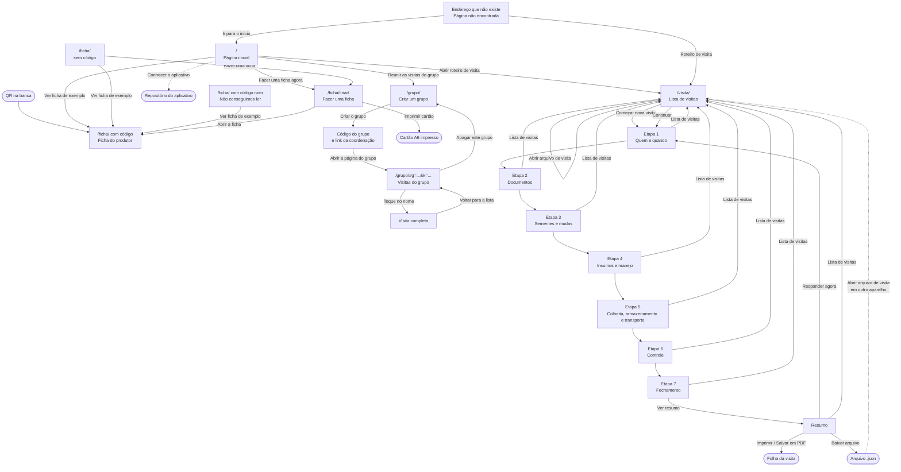

## Fluxo do comprador

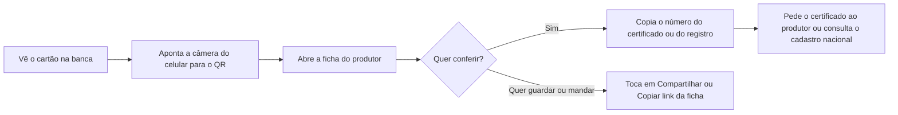

O comprador não instala nada e não precisa de conta. Em poucos segundos vê o nome do produtor, o
município e, quando o produtor informou, o selo "Produtor orgânico com certificação participativa".
Rolando a página, encontra o que ele planta, quando o caderno de campo foi atualizado e os números
para conferir. Um aviso explica que as informações são declaradas pelo produtor e como confirmá-las.

## Fluxo de quem faz a visita

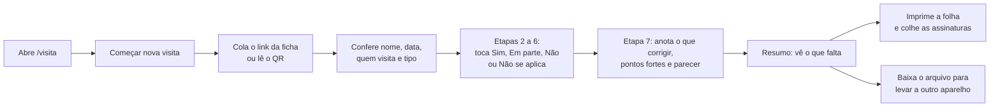

Cada toque é salvo no aparelho na hora. Dá para fechar o navegador no meio da visita e voltar
depois: a visita aparece na lista com o quanto já foi respondido.

---

## Página inicial (`/`)

  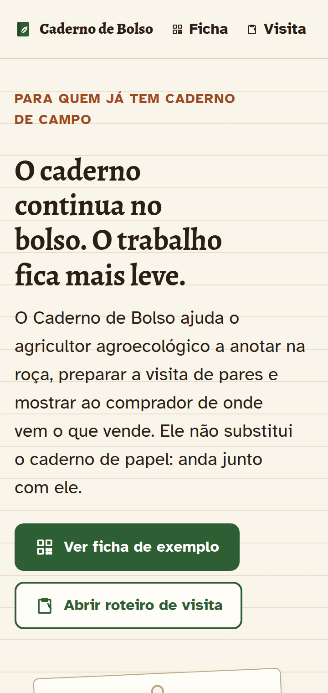

**De onde se chega:** digitando o endereço do site, pela marca no topo de qualquer página, pelo
link **Início** no rodapé ou pelo botão **Ir para o início** da página não encontrada.

**O que aparece:** você começa na página inicial e vê, no alto, o título "O caderno continua no
bolso. O trabalho fica mais leve.", um parágrafo explicando que o Caderno de Bolso anda junto com o
caderno de papel e, ao lado (ou abaixo, no celular), o desenho de um cartão de banca com nome,
município, selo e QR. Logo abaixo vêm três blocos curtos: **Anote na roça, sem internet**, **Passe a
limpo mais rápido** e **Mostre de onde vem**. Depois, **Como funciona**, em três passos numerados
(anote enquanto trabalha; gere a ficha e o QR; o comprador confere), e **Para quem é** (agricultor e
agricultora; grupo e cooperativa; quem compra na feira). Em seguida, um quadro conta que existe o
aplicativo para celular, outro quadro **Para a coordenação do grupo** e, por fim, um aviso de que é
um projeto acadêmico, sem cadastro, e que os dados ficam no aparelho, com exceção das visitas que um
membro escolhe enviar ao grupo.

**Ações:**

- Tocando em **Ver ficha de exemplo**, vai para a ficha de uma pessoa fictícia (Zé Carlos, de
  Canarana-BA).
- Tocando em **Abrir roteiro de visita**, vai para a lista de visitas.
- Tocando em **Fazer uma ficha agora**, vai para o formulário de ficha.
- Tocando em **Reunir as visitas do grupo**, vai para a página do grupo.
- Tocando em **Conhecer o aplicativo**, abre o repositório do aplicativo. Esse botão só aparece
  quando o endereço do repositório foi configurado na publicação.

**Sem internet:** abre normalmente depois que o site foi visitado uma vez naquele aparelho.

---

## Ficha do produtor (`/ficha/#d=...`)

**De onde se chega:** apontando a câmera para o QR do cartão da banca, abrindo um link de ficha
recebido por mensagem, pelo botão **Ver ficha de exemplo** (página inicial ou a própria `/ficha/`)
ou pelo botão **Abrir a ficha** do formulário de ficha.

Enquanto o navegador lê o código, aparece por um instante "Abrindo a ficha do produtor…". Depois,
a página mostra um de três estados.

### Ficha válida

  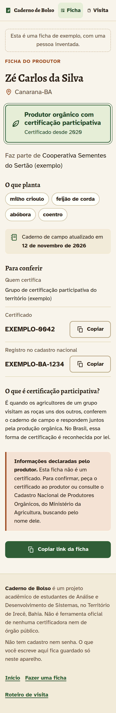

Você vê, de cima para baixo:

1. "Ficha do produtor" e, em letras grandes, o **nome do produtor**; abaixo, o **município**, se
   houver.
2. O selo **Produtor orgânico com certificação participativa**, quando o produtor informou quem
   certifica ou o número do certificado. Dentro do selo, "Certificado desde" o ano, se informado.
   Se só o ano foi informado, ele aparece numa linha simples, sem selo.
3. **Faz parte de** e o nome da cooperativa ou núcleo, se houver.
4. **O que planta**, com as culturas em etiquetas.
5. **Caderno de campo atualizado em** a data por extenso (por exemplo, "12 de novembro de 2026"),
   se houver.
6. **Para conferir**: quem certifica, o número do certificado, o registro no cadastro nacional e o
   código de rastreio. Cada número tem um botão **Copiar**, que muda para "Copiado" por alguns
   segundos. Se o aparelho não deixar copiar, aparece "Não deu para copiar. Toque e segure no texto."
7. **O que é certificação participativa?**, em duas frases simples.
8. O aviso: "Informações declaradas pelo produtor. Esta ficha não é um certificado." e como
   confirmar (pedir o certificado ao produtor ou consultar o Cadastro Nacional de Produtores
   Orgânicos, do Ministério da Agricultura, pelo nome).
9. O botão **Compartilhar**, que abre o menu de compartilhar do celular. Em aparelhos sem esse
   menu, o botão vira **Copiar link da ficha**.

Só o nome é obrigatório: as partes sem informação simplesmente não aparecem. Na ficha de exemplo,
uma faixa no alto avisa "Esta é uma ficha de exemplo, com uma pessoa inventada."

### Sem código (`/ficha/`)

  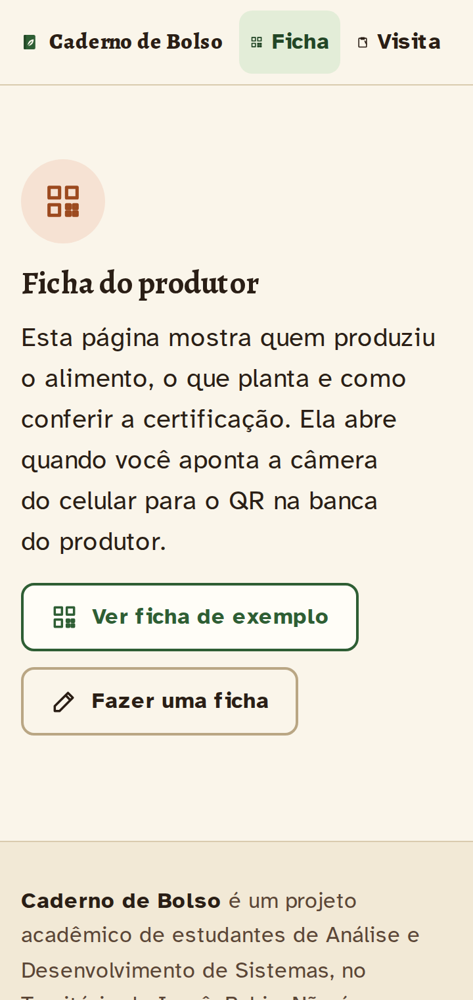

Quando se chega pelo atalho **Ficha** do topo, não há ficha para mostrar. Você vê "Ficha do
produtor" e a explicação de que a página mostra quem produziu o alimento e abre quando se aponta a
câmera para o QR da banca. Tocando em **Ver ficha de exemplo**, a ficha de exemplo aparece na mesma
página. Tocando em **Fazer uma ficha**, vai para o formulário de ficha.

### Código que não dá para ler

  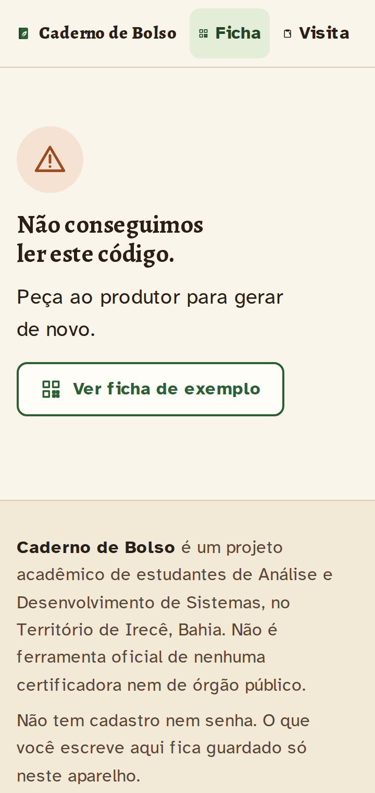

Quando o link está cortado, foi alterado ou não segue o formato, aparece "Não conseguimos ler este
código." e "Peça ao produtor para gerar de novo." Se o código foi feito por uma versão mais nova do
aplicativo, a mensagem diz isso. Há o botão **Ver ficha de exemplo**.

**Sem internet:** a ficha abre sem internet quando o site já foi aberto antes naquele aparelho. Para
quem nunca entrou no site, a primeira leitura do QR precisa de internet.

---

## Fazer uma ficha (`/ficha/criar/`)

  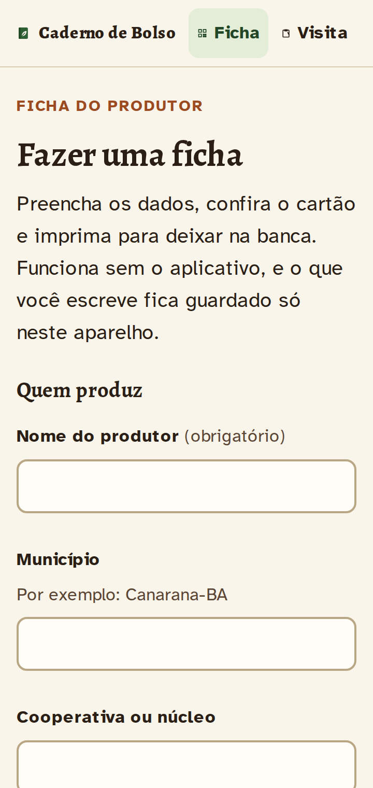
  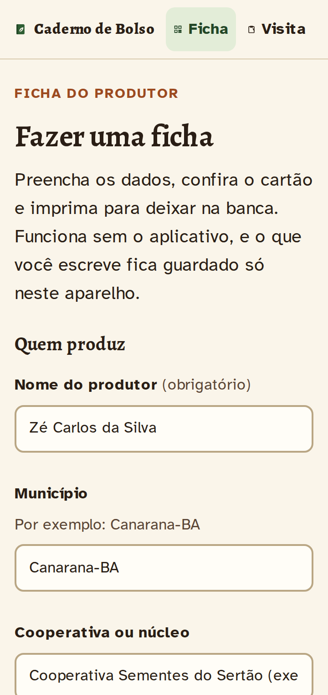
  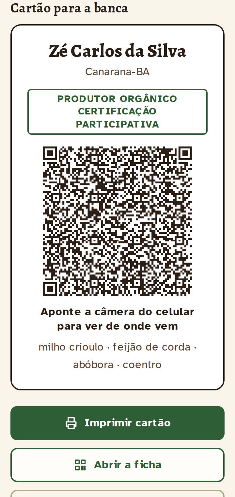

**De onde se chega:** pelo botão **Fazer uma ficha agora** da página inicial, pelo botão **Fazer uma
ficha** da `/ficha/` sem código ou pelo link **Fazer uma ficha** do rodapé.

**O que aparece:** o título "Fazer uma ficha" e um formulário em três partes. No celular, logo
abaixo do formulário, fica o **Cartão para a banca**; em telas largas, o cartão fica ao lado e
acompanha a rolagem.

- **Quem produz:** Nome do produtor (**obrigatório**), Município e Cooperativa ou núcleo.
- **O que planta:** Culturas, separadas por vírgula, e Última anotação no caderno de campo (data).
- **Certificação** (tudo opcional, "deixe em branco o que não tiver"): Quem certifica, Número ou
  identificação do certificado, Registro no cadastro nacional de produtores orgânicos, Código de
  rastreio e Certificado desde (ano).

Enquanto o nome está vazio, o lugar do cartão mostra "Escreva o nome do produtor para ver o cartão
e o QR." Assim que há um nome, o cartão aparece com nome, município, selo (se houver quem certifica
ou número do certificado), o QR, a frase "Aponte a câmera do celular para ver de onde vem" e até
quatro culturas. O cartão se atualiza a cada letra digitada.

**Avisos dos campos:**

- Perto do limite de cada campo, aparece "Ainda cabem N letras". No limite, "Chegou ao limite de N
  letras". O campo não aceita além disso.
- Ano com menos de quatro números: "Escreva o ano com quatro números, por exemplo 2020."
- Mais de 12 culturas: "A ficha mostra até 12 culturas. As outras ficam de fora."
- Cultura com mais de 40 letras: o aviso cita qual cultura encurtar.

**Ações:**

- Tocando em **Imprimir cartão**, abre a impressão só com o cartão, no tamanho A6. A dica abaixo
  lembra que dá para imprimir em A4 e recortar.
- Tocando em **Abrir a ficha**, vai para a ficha do produtor como o comprador vai ver.
- Tocando em **Copiar link**, copia o endereço da ficha (para mandar por mensagem, por exemplo).
- Tocando em **Baixar imagem do QR**, salva o QR como imagem.
- Tocando em **Limpar formulário**, apaga todos os campos.

O que é digitado fica guardado no aparelho: fechando e voltando à página, o formulário continua
preenchido.

**Sem internet:** funciona inteiro, incluindo o QR, depois que o site foi aberto uma vez.

---

## Roteiro de apoio à visita: lista (`/visita/`)

  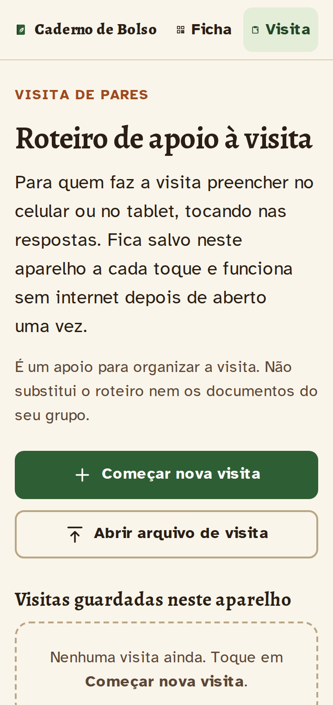
  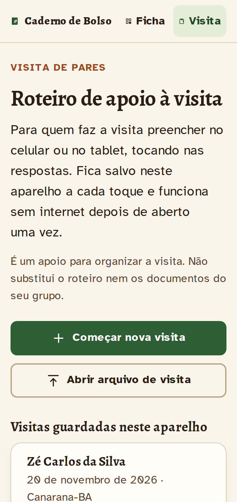

**De onde se chega:** pelo atalho **Visita** do topo, pelo botão **Abrir roteiro de visita** da
página inicial, pelo link **Roteiro de visita** do rodapé ou da página não encontrada, ou pelo
botão **Lista de visitas** dentro de uma visita. Instalado como aplicativo no celular, o ícone abre
direto aqui.

**O que aparece:** o título "Roteiro de apoio à visita", a explicação de que se preenche tocando
nas respostas, que salva a cada toque e funciona sem internet, e o lembrete de que é um apoio e não
substitui o roteiro nem os documentos do grupo. Abaixo, os botões **Começar nova visita** e **Abrir
arquivo de visita** e a seção **Visitas guardadas neste aparelho**.

Sem visitas, aparece "Nenhuma visita ainda. Toque em Começar nova visita." Com visitas, cada uma
aparece num cartão com o nome do produtor (ou "Produtor sem nome"), a data por extenso, o município,
uma barra de progresso e "N de M respondidas". A mais recente fica em cima.

**Ações:**

- Tocando em **Começar nova visita**, uma visita nova é criada, já com a data de hoje, e você vai
  para a Etapa 1.
- Tocando em **Continuar** num cartão, vai para a Etapa 1 daquela visita, com tudo o que já foi
  respondido.
- Tocando em **Apagar**, o cartão pergunta "Apagar a visita de X? Não dá para desfazer." Tocando em
  **Sim, apagar**, a visita some e aparece "Visita de X apagada." **Cancelar** volta ao cartão.
- Tocando em **Abrir arquivo de visita**, o aparelho pede para escolher um arquivo baixado em
  outro aparelho.
  - Visita que ainda não existe neste aparelho: é guardada e aparece "Visita aberta e guardada
    neste aparelho."
  - Visita que já existe aqui, mas é mais antiga que a do arquivo: é substituída e aparece "A do
    arquivo era mais nova e substituiu a que estava neste aparelho."
  - Visita que já existe aqui e foi alterada **depois** da do arquivo: aparece "Este aparelho tem
    uma versão mais nova desta visita", com as duas datas, e três escolhas: **Guardar o arquivo
    como cópia** (as duas ficam na lista, a do arquivo com "(cópia)" no nome), **Substituir pela do
    arquivo** ou **Cancelar** ("Nada foi mudado.").
  - Arquivo que não é visita: "Este arquivo não é uma visita do Caderno de Bolso." Feito por versão
    diferente do roteiro: "Este arquivo foi feito por uma versão diferente do roteiro." Muito
    grande: "Este arquivo é grande demais para ser uma visita."

**Mensagens de problema:**

- Aparelho sem espaço: "O aparelho está sem espaço para guardar a visita."
- Dados guardados estragados (por exemplo, depois de uma falha do navegador): aparece "Algumas
  visitas guardadas neste aparelho estão estragadas e não dá para abri-las aqui." O site guarda uma
  cópia do conteúdo antes de mexer em qualquer coisa e oferece **Baixar a cópia guardada** e
  **Apagar a cópia guardada** (que pede confirmação: **Sim, apagar a cópia**).

**Sem internet:** funciona inteiro depois que o site foi aberto uma vez.

---

## Roteiro de apoio à visita: dentro de uma visita

**O que aparece em todas as etapas:** no alto, o botão **Lista de visitas** e, depois do primeiro
toque, a confirmação discreta "Salvo neste aparelho". Abaixo, "Visita a" e o nome do produtor (ou
"Nova visita"), a barra de progresso com "N de M respondidas" e a fileira de botões das etapas,
numerados de 1 a 7, mais **Resumo**. A etapa atual fica destacada. Tocando em qualquer número, vai
direto para aquela etapa: dá para pular e voltar à vontade.

No pé da tela, sempre visível, ficam **Voltar** (a partir da Etapa 2) e **Próxima etapa** (na Etapa
7, o botão se chama **Ver resumo**).

**Como se responde cada pergunta:** a pergunta aparece em negrito, às vezes com uma explicação
curta embaixo, e quatro botões grandes: **Sim**, **Em parte**, **Não** e **Não se aplica**. A
resposta escolhida fica colorida. Abaixo de cada pergunta há **Anotar observação**, que abre um
campo de texto opcional. As respostas e observações podem ser mudadas a qualquer momento.

O que conta como "respondido" na barra de progresso: as perguntas de Sim/Não visíveis, o nome do
produtor, a data, o tipo de visita, o uso do armazém (e, se compartilhado, como é feita a
separação) e o parecer. Todo o resto é opcional.

Se o aparelho ficar sem espaço, no lugar de "Salvo neste aparelho" aparece "Não foi possível
salvar: aparelho sem espaço".

### Etapa 1. Quem e quando

  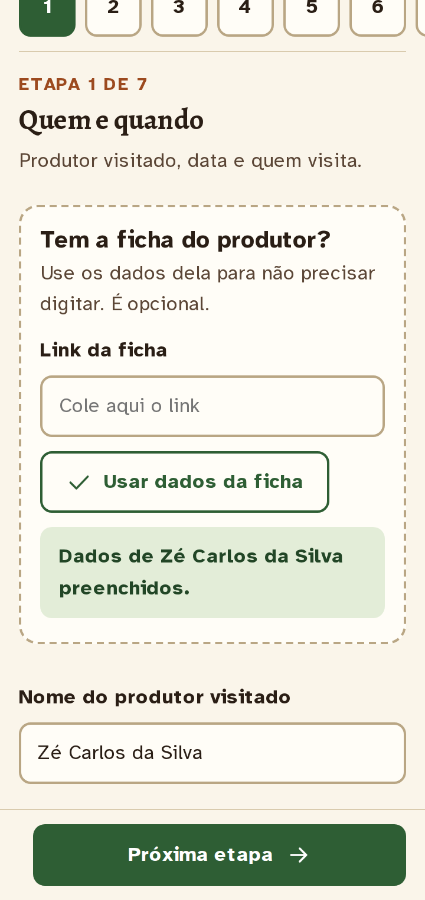

No topo, o quadro **Tem a ficha do produtor?**, opcional, para não precisar digitar. Você cola o
link da ficha no campo **Link da ficha** e toca em **Usar dados da ficha** (ou aperta Enter). O
nome, o município e as culturas são preenchidos, e as culturas que pedem comprovação de origem
(algodão, feijão, milho, soja) já ficam marcadas na Etapa 3. Aparece "Dados de X preenchidos." Em
celulares cujo navegador sabe ler QR em foto, aparece também **Ler o QR com a câmera**, que abre a
câmera para fotografar o QR da banca.

Mensagens do quadro: campo vazio, "Cole o link da ficha que aparece ao ler o QR do produtor.";
link cortado ou errado, "Não conseguimos ler esta ficha. Confira se o link está completo."; foto
sem QR, "Não achamos um QR na foto. Tente chegar mais perto."

Depois vêm os campos: **Nome do produtor visitado** (obrigatório), **Município**, a lista de
culturas vinda da ficha (se houver), **Data da visita** (já vem com a data de hoje, obrigatória),
**Quem está visitando** (os nomes, separados por vírgula) e **Tipo de visita** (obrigatório): **Visita
de pares** (feita por agricultores do grupo) ou **Olhar externo** (com alguém de fora do grupo).

### Etapa 2. Documentos

  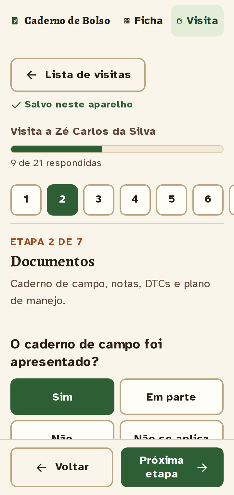

Seis perguntas: o caderno de campo foi apresentado; o caderno está em dia (plantios, tratos,
colheitas e vendas anotados até a semana da visita); as notas fiscais e recibos estão guardados;
as DTCs entregues aos compradores estão guardadas; o plano de manejo está atualizado; o plano de
manejo bate com o que foi visto na roça.

### Etapa 3. Sementes e mudas

  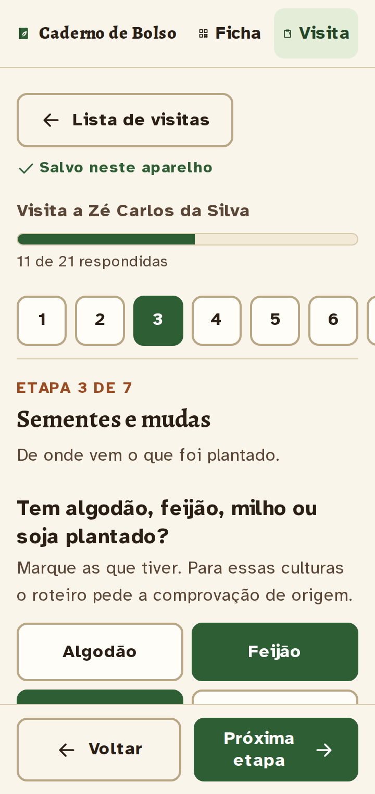

Primeiro, **Tem algodão, feijão, milho ou soja plantado?**, com quatro opções para marcar (pode
marcar mais de uma, ou nenhuma). Depois, a pergunta **A origem das sementes e mudas está
anotada?**. Se alguma das quatro culturas estiver marcada, aparece também **Há comprovação de
origem do material plantado dessas culturas?** (declaração de que não é transgênico, nota de
compra ou registro da troca). Desmarcando todas, essa pergunta some e deixa de contar no progresso.

### Etapa 4. Insumos e manejo

  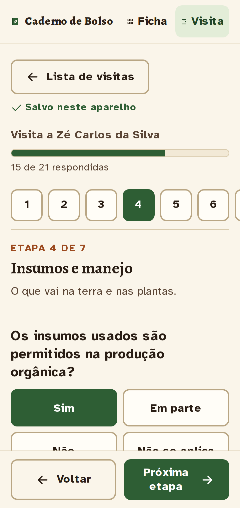

Quatro perguntas: os insumos usados são permitidos na produção orgânica; a origem dos insumos está
registrada; as caldas e adubos aplicados estão anotados no caderno; há proteção contra contaminação
vinda do vizinho (barreira de plantas, distância ou outro cuidado).

### Etapa 5. Colheita, armazenamento e transporte

  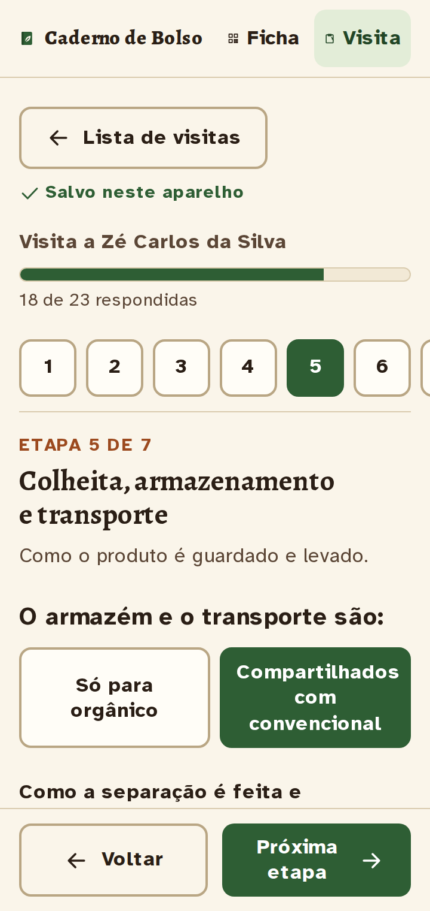

Primeiro, **O armazém e o transporte são:** **Só para orgânico** ou **Compartilhados com
convencional** (obrigatório). Escolhendo compartilhados, aparecem o campo **Como a separação é
feita e registrada?** (obrigatório nesse caso) e a pergunta **A separação do produto orgânico está
sendo feita e anotada?**. Em qualquer caso, há as perguntas **A colheita está anotada no caderno?**
e **As embalagens e sacarias estão limpas e identificadas?**.

### Etapa 6. Controle

  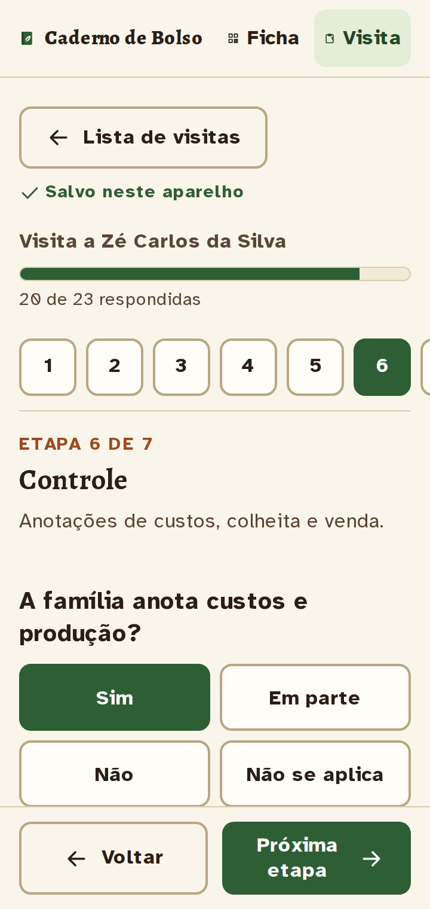

Duas perguntas: a família anota custos e produção; as quantidades colhidas e vendidas fazem sentido
entre si (não se vende mais do que se colheu).

### Etapa 7. Fechamento

  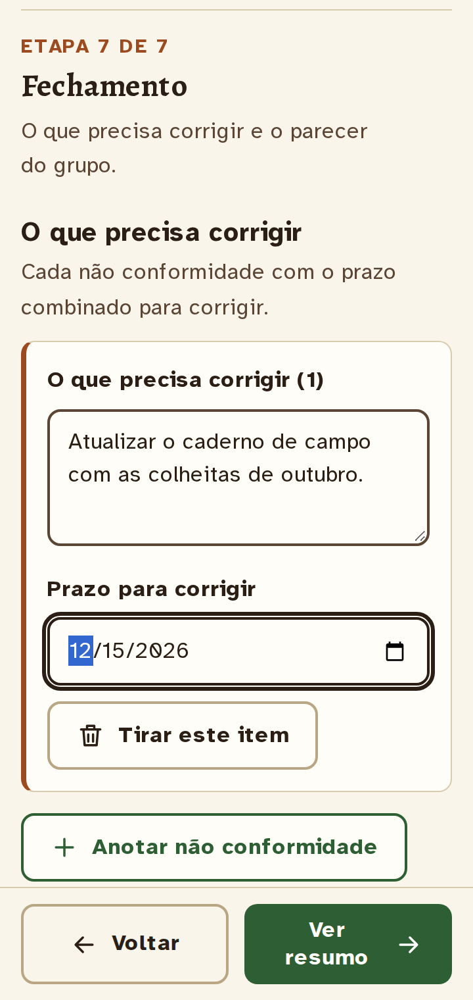

**O que precisa corrigir:** começa com "Nenhuma anotada." Tocando em **Anotar não conformidade**,
aparece um item com o campo do que precisa corrigir e o **Prazo para corrigir** (data). Cada item
tem **Tirar este item**. Dá para anotar quantos forem precisos.

Depois, **Pontos fortes** (o que a família está fazendo bem), **Observações** e o **Parecer da
visita** (obrigatório): **Conforme**, **Conforme com pendências** ou **Não conforme**, cada um com
uma frase explicando. Tocando em **Ver resumo**, vai para o Resumo.

### Resumo

  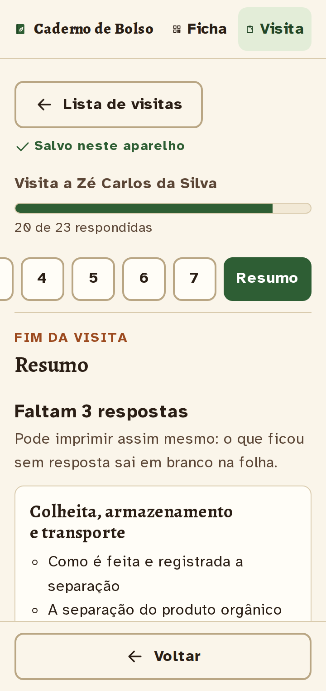

Se tudo foi respondido, aparece "Tudo respondido. Pode imprimir ou guardar o arquivo." Senão,
aparece "Faltam N respostas", com a lista do que ficou em branco agrupada por etapa e, em cada
grupo, o botão **Responder agora**, que leva direto àquela etapa. Também avisa que dá para imprimir
assim mesmo: o que ficou sem resposta sai em branco.

**Ações:**

- Tocando em **Imprimir / Salvar em PDF**, abre a impressão com uma folha limpa, em preto e branco:
  dados da visita, uma tabela por etapa com pergunta, resposta e observação, as não conformidades
  com prazos, pontos fortes, observações, o parecer marcado e três linhas de assinatura (produtor
  visitado e duas de quem visitou). No celular, a opção "Salvar como PDF" da impressão gera o
  arquivo.
- Tocando em **Baixar arquivo**, salva um arquivo `.json` com a visita (por exemplo,
  `visita-ze-carlos-da-silva-2026-11-20.json`). Em outro aparelho, ele é aberto pela lista, em
  **Abrir arquivo de visita**.

**Sem internet:** todas as etapas, o resumo, a impressão e o arquivo funcionam sem internet depois
que o site foi aberto uma vez.

---

## Visitas do grupo (`/grupo/`)

Para a coordenação de um núcleo, associação ou cooperativa. Os produtores fazem a visita de pares
no aplicativo e enviam ao grupo; aqui a coordenação vê todas num lugar só. O grupo tem dois
segredos: o **código do grupo**, curto, que os membros digitam no aplicativo para enviar, e o
**link da coordenação**, que é o único jeito de ver as visitas. Não há login.

**De onde se chega:** pelo botão **Reunir as visitas do grupo** da página inicial, pelo link **Para a
coordenação do grupo** do rodapé ou abrindo o link da coordenação.

### Criar um grupo

**O que aparece:** "Para a coordenação do grupo", o título "Reunir as visitas do grupo", uma
explicação curta e **Como funciona**, em três passos (você cria o grupo e recebe o código e o link;
cada membro digita o código no aplicativo e escolhe quais visitas enviar; pelo link você vê as que
chegaram). Abaixo, o quadro **Criar um grupo**, com o campo **Nome do grupo** e o botão **Criar o
grupo**. Se este aparelho lembra de um grupo, aparece antes o quadro **Grupo lembrado neste
aparelho**, com **Abrir as visitas deste grupo**. No pé da página, um texto sobre os dados.

**Ações e mensagens:**

- Nome vazio: "Escreva o nome do grupo para continuar."
- Tocando em **Criar o grupo**, o botão vira "Criando o grupo…". Sem internet: "Sem internet agora.
  Para criar o grupo é preciso estar conectado. Tente de novo." Falha do servidor: "O servidor teve
  um problema e o grupo não foi criado. Tente de novo daqui a pouco."

### Grupo criado

**O que aparece:** "Grupo criado", o nome do grupo e "Guarde as duas coisas abaixo agora. Elas não
aparecem de novo." Depois, duas partes:

1. **Código do grupo, para os membros.** Um cartão com "Código do grupo", o nome do grupo, o código
   em letras grandes no formato `XXXXX-XXXXX`, um QR e duas frases dizendo o que o membro faz no
   aplicativo (aba Visita, Visitar outra roça, Grupo, digitar o código). O código não usa as letras
   I, L e O nem os números 0 e 1, para não confundir. Botões **Copiar código** e **Imprimir cartão
   do código** (a impressão sai só com o cartão, sem o link da coordenação).
2. **Link da coordenação, só para você.** Um aviso em destaque: "Quem tiver este link vê todas as
   visitas do grupo. Guarde num lugar seguro e não compartilhe. Se perder, não há como recuperar."
   O link aparece num campo de texto, com **Copiar link** e **Abrir a página do grupo**. Por último,
   a caixa **Lembrar neste aparelho**: marcada, a página do grupo abre sozinha neste aparelho, e o
   código continua aparecendo nela. O texto pede para marcar só se o aparelho for seu.

### Visitas do grupo (`/grupo/#g=...&k=...`)

**O que aparece:** "Visitas do grupo", o nome do grupo, quantas visitas foram reunidas e quando
chegou a última. Os botões **Atualizar** e **Baixar planilha (CSV)**. Enquanto carrega, "Carregando
as visitas do grupo…".

- **Resumo:** quadros com o total de visitas, os produtores visitados e quantas visitas têm parecer
  Conforme, Com pendências, Não conforme e Sem parecer. Abaixo, a tabela **Perguntas com mais
  respostas Não e Em parte**, com as contagens e uma barra para cada pergunta.
- **Visitas recebidas:** o filtro **Parecer**, a busca **Buscar pelo nome do produtor** (não liga
  para acento) e "Mostrando N de M visitas". A tabela tem produtor visitado, município, data da
  visita, quem visitou, tipo, parecer, respondidas ("N de M") e recebida em. No celular, ela rola
  de lado.
- **Código do grupo**, quando o grupo foi criado e lembrado neste aparelho, com **Copiar código**.
- **Neste aparelho:** a caixa **Lembrar neste aparelho**, **Copiar link da coordenação** e **Criar
  outro grupo**.
- **Apagar este grupo.**
- O texto sobre os dados: as visitas foram enviadas por membros que digitaram o código e
  concordaram em enviar, trazem o nome do produtor visitado, e a página não guarda as visitas no
  aparelho.

**Ações:**

- Tocando no nome de um produtor, abre a visita inteira, só para leitura, na mesma folha que o
  roteiro imprime, com "Recebida em" e a data. **Imprimir / Salvar em PDF** imprime a folha, com
  as linhas de assinatura. **Voltar para a lista** volta para a tabela.
- **Baixar planilha (CSV)** salva um arquivo como `visitas-nucleo-boa-vista-2026-11-20.csv`, que
  abre no Excel com os acentos certos: uma linha por visita, as colunas da tabela, as contagens de
  Não, de Em parte e de não conformidades anotadas e uma coluna por pergunta.
- **Apagar este grupo** pergunta antes: "Apagar o grupo X e as N visitas reunidas? Tudo some do
  servidor para sempre, não dá para desfazer, e o código deixa de funcionar no aplicativo dos
  membros." Tocando em **Sim, apagar tudo**, volta para a criação de grupo com "O grupo X foi
  apagado, com todas as visitas reunidas." **Cancelar** desfaz a pergunta.

**Mensagens:**

- Grupo sem visitas: "Nenhuma visita chegou ainda", com o caminho no aplicativo para o membro
  enviar.
- Link incompleto ou alterado: "Não conseguimos ler este link", com o botão para voltar ao começo
  da página do grupo.
- Link que não abre grupo (chave errada ou grupo apagado): "Este link não abre nenhum grupo.", com
  **Criar um grupo** e, se o aparelho lembrava dele, **Esquecer este grupo neste aparelho**.
- Falha do servidor: "O servidor teve um problema. Tente atualizar daqui a pouco."

**Sem internet:** a página abre, porque fica guardada no aparelho como as outras, mas as visitas
não: aparece "Sem internet agora. Confira a conexão e toque em Atualizar." Se a lista já tinha sido
carregada antes, ela continua na tela com "Mostrando o que foi carregado às HH:MM. Esta cópia fica
só nesta página e some ao fechar."

---

## Página não encontrada

  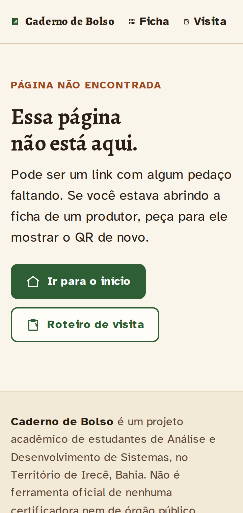

**De onde se chega:** por um endereço que não existe no site, por exemplo um link cortado.

**O que aparece:** "Essa página não está aqui." e a explicação de que pode ser um link com algum
pedaço faltando. Se a pessoa estava abrindo a ficha de um produtor, a página sugere pedir que ele
mostre o QR de novo.

**Ações:** **Ir para o início** leva à página inicial; **Roteiro de visita** leva à lista de
visitas.

---

## Página → dor ou ganho que atende

| Página                    | Dor ou ganho que atende                                                                                                                                                                                      |
| ------------------------- | ------------------------------------------------------------------------------------------------------------------------------------------------------------------------------------------------------------ |
| Ficha do produtor         | **Provar a cada venda que é orgânico:** o QR na banca responde pelo produtor, sem foto nem convite para a roça. **Comprador conferir sozinho:** os números para conferir e como fazer isso estão na tela.    |
| Fazer uma ficha           | **Provar a cada venda que é orgânico:** gera o QR e o cartão da banca mesmo para quem não usa o aplicativo, inclusive pela cooperativa.                                                                      |
| Roteiro de apoio à visita | **Visita que toma o dia inteiro (hipótese, citada por um produtor):** respostas com um toque, perguntas que só aparecem quando fazem sentido, dados da ficha sem digitar e folha pronta para assinar no fim. |
| Roteiro de apoio à visita | **Estar pronto para a visita:** o produtor e o grupo podem percorrer o mesmo roteiro antes da visita e ver, no resumo, o que ainda falta acertar.                                                            |
| Visitas do grupo          | **A visita de pares é longa:** as visitas feitas no aplicativo chegam prontas à coordenação, com resumo, folha para imprimir e planilha, sem passar a limpo de novo.                                         |
| Página inicial            | Explica o projeto ao produtor, à cooperativa e a quem avalia, e leva às ferramentas e à ficha de exemplo.                                                                                                    |
