# Telas

As 18 capturas do site, em tamanho de celular, numeradas na ordem em que a pessoa encontra cada tela. O nome do arquivo segue o mesmo número. O passo a passo completo de cada tela está em [fluxos.md](../fluxos.md).

| Parte                     | Telas   |
| ------------------------- | ------- |
| Página inicial            | 01      |
| Ficha do produtor         | 02 a 04 |
| Fazer uma ficha           | 05 a 07 |
| Roteiro de apoio à visita | 08 a 17 |
| Outras                    | 18      |

## Página inicial

| Nº  | Tela               | Como chegar  | O que faz                                                                          | Captura                                                                                |
| --- | ------------------ | ------------ | ---------------------------------------------------------------------------------- | -------------------------------------------------------------------------------------- |
| 01  | **Página inicial** | Abrir o site | Apresenta o projeto e leva para a ficha, o gerador de ficha e o roteiro de visita. | <a href="01-inicio.png">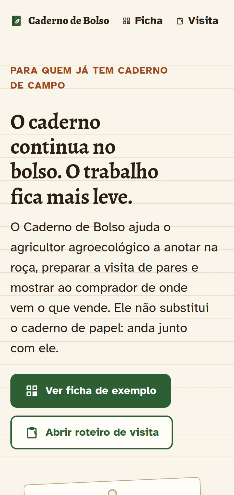</a> |

## Ficha do produtor

O que o comprador vê ao ler o QR da banca.

| Nº  | Tela                           | Como chegar                                 | O que faz                                                                             | Captura                                                                                                                          |
| --- | ------------------------------ | ------------------------------------------- | ------------------------------------------------------------------------------------- | -------------------------------------------------------------------------------------------------------------------------------- |
| 02  | **Ficha válida**               | Ler o QR ou abrir o link da ficha           | Quem produz, de onde é, o que planta e os dados para conferir o certificado.          | <a href="02-ficha.png">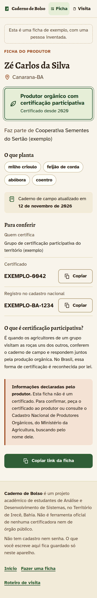</a>                                               |
| 03  | **Ficha sem código**           | Abrir /ficha/ sem ter lido um QR            | Explica que a ficha abre pelo QR e oferece o gerador.                                 | <a href="03-ficha-sem-codigo.png">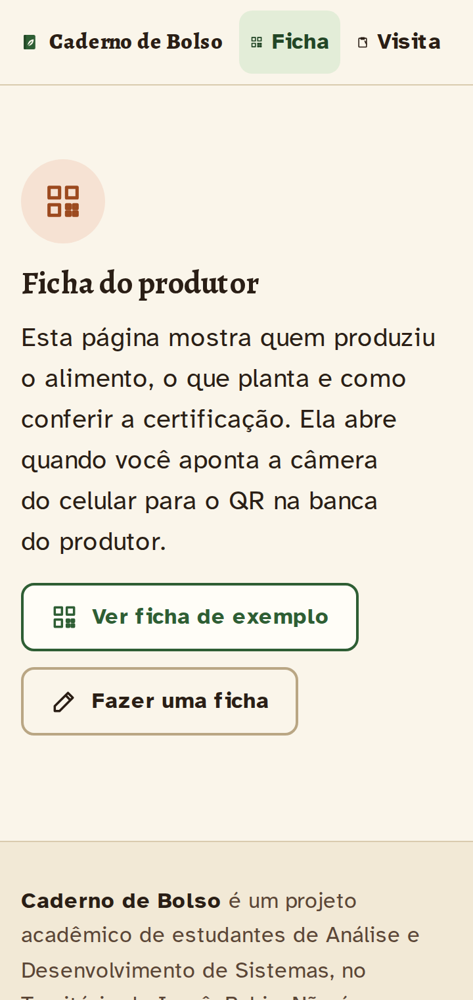</a>                     |
| 04  | **Código que não dá para ler** | Abrir um link de ficha cortado ou estragado | Avisa que o código não pôde ser lido, diz o que fazer e oferece uma ficha de exemplo. | <a href="04-ficha-codigo-ilegivel.png">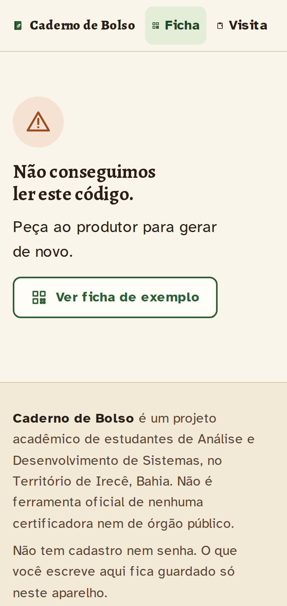</a> |

## Fazer uma ficha

Para o produtor ou a cooperativa montar a ficha sem o aplicativo.

| Nº  | Tela                      | Como chegar                            | O que faz                                                                                                                           | Captura                                                                                                                                       |
| --- | ------------------------- | -------------------------------------- | ----------------------------------------------------------------------------------------------------------------------------------- | --------------------------------------------------------------------------------------------------------------------------------------------- |
| 05  | **Formulário vazio**      | Página inicial → Fazer uma ficha agora | Só o nome é obrigatório.                                                                                                            | <a href="05-criar-ficha-vazio.png">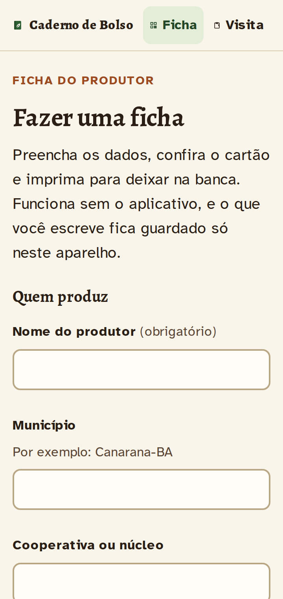</a>                                |
| 06  | **Formulário preenchido** | Preencher os campos                    | Cada campo mostra o limite de letras.                                                                                               | <a href="06-criar-ficha-preenchido.png">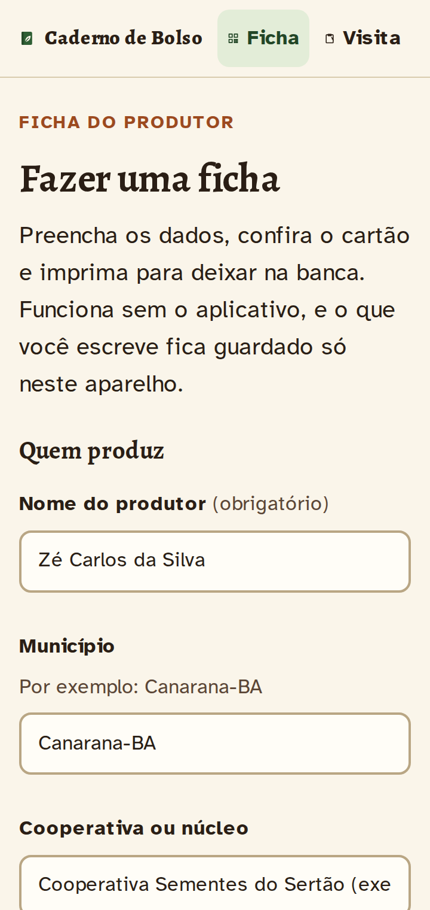</a>                 |
| 07  | **Cartão para a banca**   | Escrever o nome do produtor            | Aparece abaixo do formulário e se atualiza a cada letra. Botões para imprimir o cartão, abrir a ficha, copiar o link e baixar o QR. | <a href="07-criar-ficha-cartao-para-a-banca.png">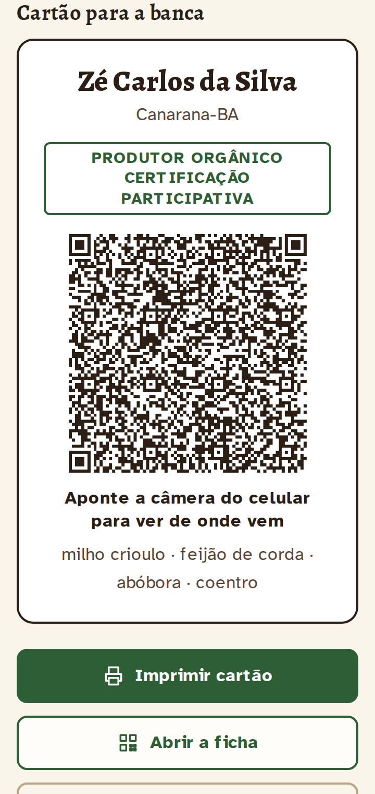</a> |

## Roteiro de apoio à visita

Para quem faz a visita de pares. Funciona sem internet depois de aberto uma vez.

| Nº  | Tela                                              | Como chegar                                | O que faz                                                                                                                            | Captura                                                                                                                                                                                 |
| --- | ------------------------------------------------- | ------------------------------------------ | ------------------------------------------------------------------------------------------------------------------------------------ | --------------------------------------------------------------------------------------------------------------------------------------------------------------------------------------- |
| 08  | **Lista de visitas vazia**                        | Tocar em Visita, no menu do alto           | Começar uma visita nova ou trazer uma de outro aparelho.                                                                             | <a href="08-visita-lista-vazia.png">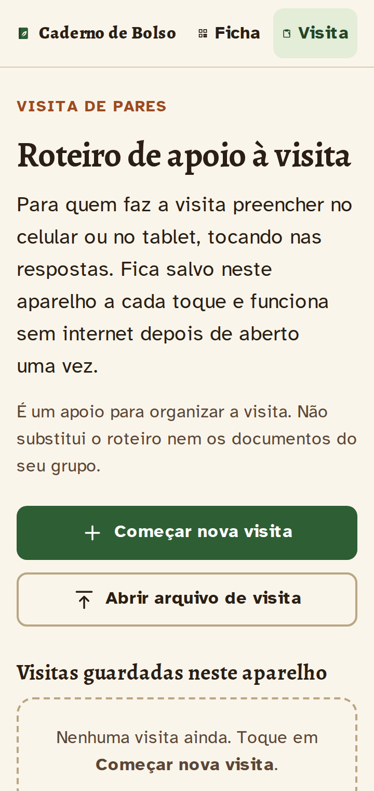</a>                                                                  |
| 09  | **Lista de visitas**                              | Voltar à lista com uma visita em andamento | Mostra quanto de cada visita já foi respondido.                                                                                      | <a href="09-visita-lista.png">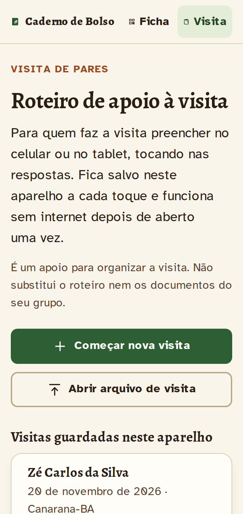</a>                                                                                    |
| 10  | **Etapa 1: Quem e quando**                        | Abrir uma visita                           | Produtor visitado, data, quem está visitando e tipo de visita. Colar o link da ficha preenche os dados sozinho.                      | <a href="10-visita-etapa-1-quem-e-quando.png">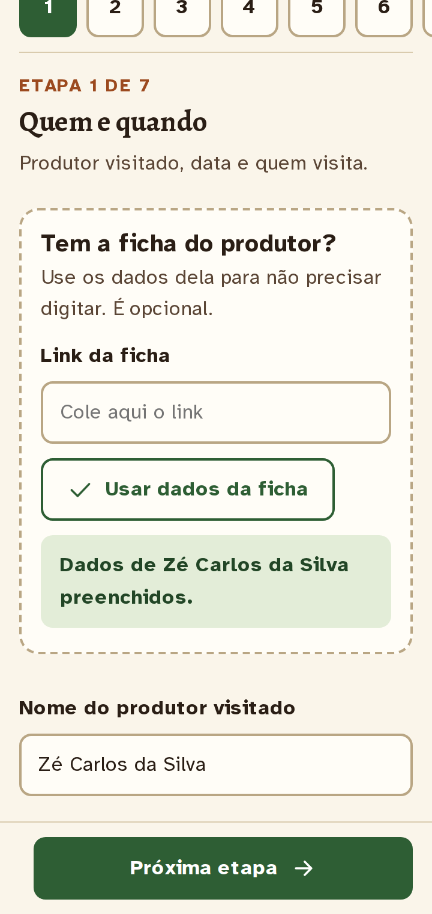</a>                                              |
| 11  | **Etapa 2: Documentos**                           | Próxima etapa                              | Seis perguntas sobre caderno, notas, DTCs e plano de manejo. Cada uma se responde com um toque: Sim, Em parte, Não ou Não se aplica. | <a href="11-visita-etapa-2-documentos.png">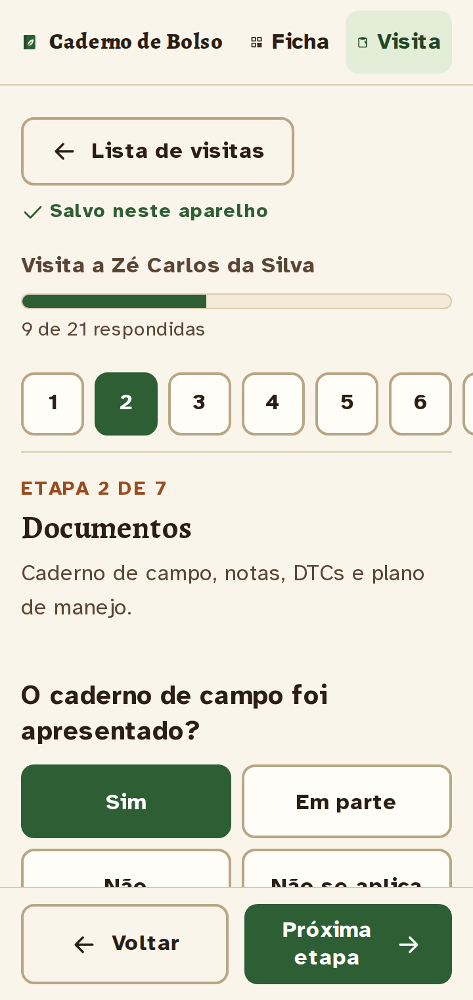</a>                                                       |
| 12  | **Etapa 3: Sementes e mudas**                     | Próxima etapa                              | A comprovação de origem só aparece para algodão, feijão, milho e soja.                                                               | <a href="12-visita-etapa-3-sementes-e-mudas.png">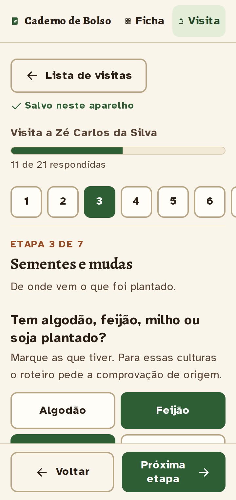</a>                                     |
| 13  | **Etapa 4: Insumos e manejo**                     | Próxima etapa                              | Insumos permitidos, origem registrada, caldas anotadas e proteção contra contaminação vinda do vizinho.                              | <a href="13-visita-etapa-4-insumos-e-manejo.png">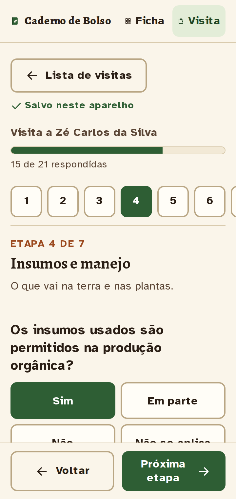</a>                                     |
| 14  | **Etapa 5: Colheita, armazenamento e transporte** | Próxima etapa                              | A separação do produto só é pedida quando o armazém é compartilhado.                                                                 | <a href="14-visita-etapa-5-colheita-e-armazenamento.png">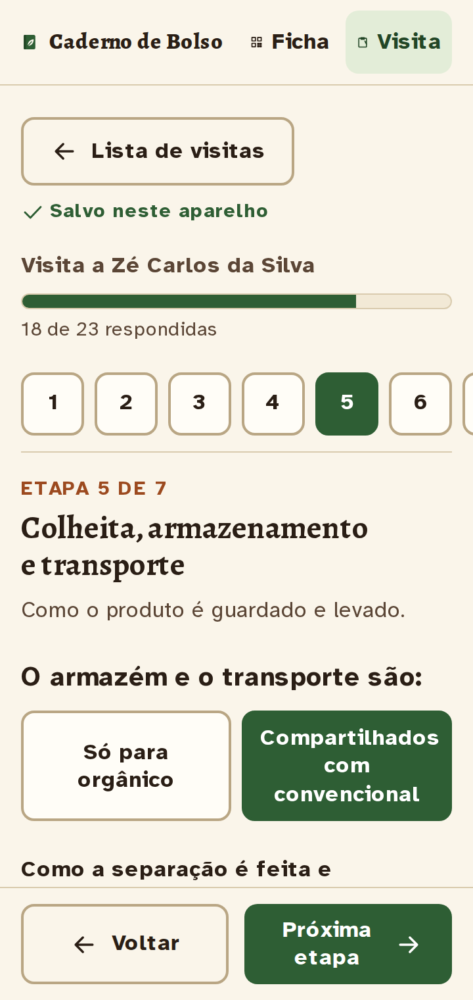</a> |
| 15  | **Etapa 6: Controle**                             | Próxima etapa                              | Se a família anota custos e produção e se colheita e venda fazem sentido entre si.                                                   | <a href="15-visita-etapa-6-controle.png">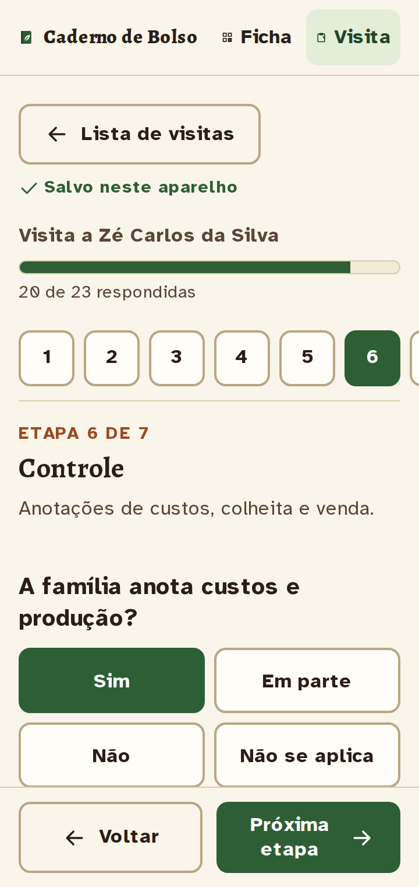</a>                                                             |
| 16  | **Etapa 7: Fechamento**                           | Próxima etapa                              | O que precisa corrigir, com prazo, pontos fortes, observações e o parecer da visita.                                                 | <a href="16-visita-etapa-7-fechamento.png">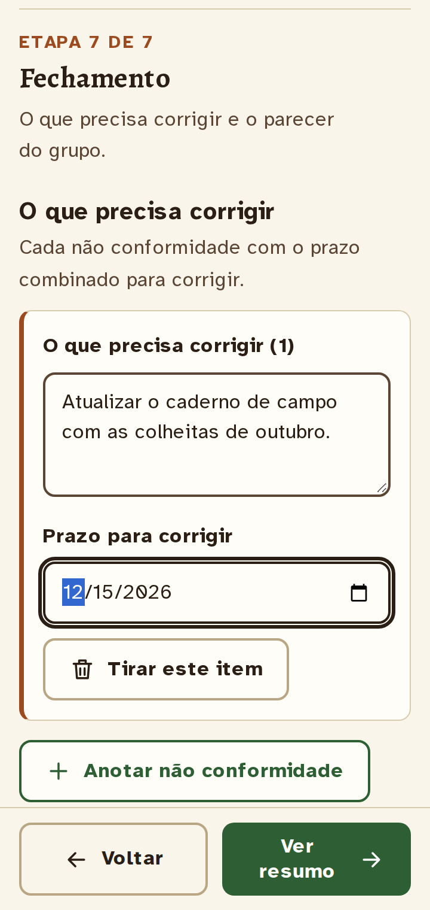</a>                                                       |
| 17  | **Resumo**                                        | Tocar em Ver resumo, na etapa 7            | Mostra o que ficou sem resposta e leva para imprimir ou salvar em PDF.                                                               | <a href="17-visita-resumo.png">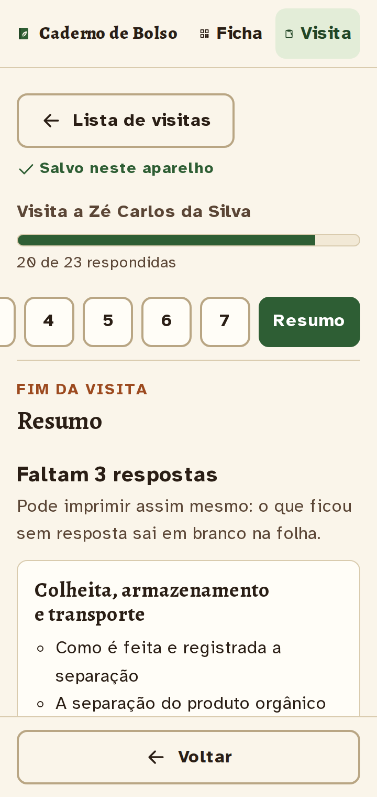</a>                                                                                            |

## Outras

| Nº  | Tela                      | Como chegar                      | O que faz                     | Captura                                                                                                                     |
| --- | ------------------------- | -------------------------------- | ----------------------------- | --------------------------------------------------------------------------------------------------------------------------- |
| 18  | **Página não encontrada** | Abrir um endereço que não existe | Aviso com o caminho de volta. | <a href="18-pagina-nao-encontrada.png">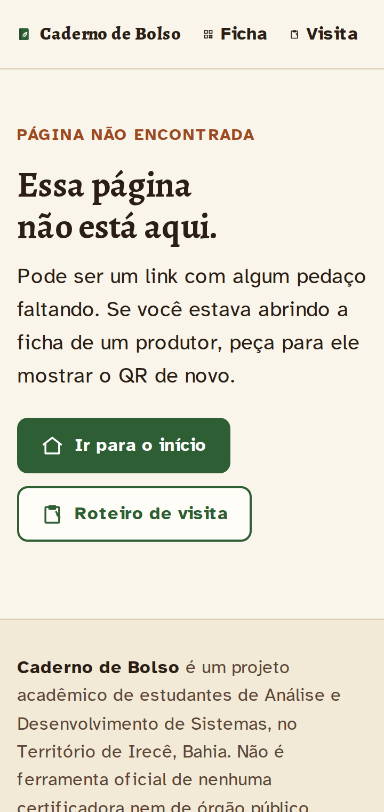</a> |
